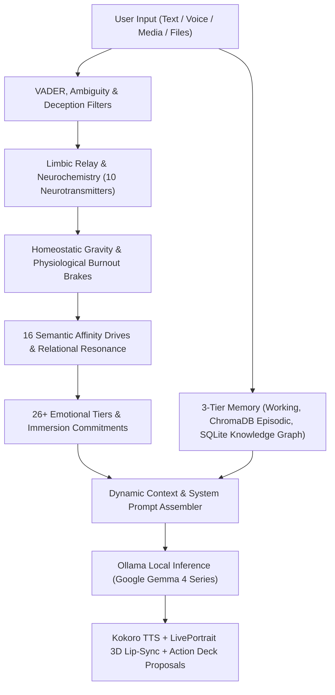

# Say Hello to Calypso -
**A Local-First, Multi-Modal Cognitive & Neurochemical Simulation Engine and Chatbot Companion**

[](LICENSE)
[](https://www.python.org/)
[](https://ollama.com/)
[](#privacy--100-offline-first-design)

**Calypso (Emotion Engine)** is a local-first multi-modal cognitive simulation engine integrating **Google Gemma 4** language & vision models (via Ollama), a biologically inspired **neurochemical & homeostatic subsystem**, **3-tier persistent vector & knowledge-graph memory**, real-time **FasterLivePortrait + JoyVASA 3D neural lip-sync**, local **SDXL scene generation with identity preservation**, **AudioCraft / MusicGen** acoustic synthesis, **Kokoro-82M** neural TTS, and **Faster-Whisper** voice recognition.
---

## AI Usage for Coding Tasks

AI was heavily used to complete this project. Initially this adventure began as a simple chatbot program to teach myself Python. The emotion engine itself is 70 percent my own work while the rest leaned heavily into AI tools for code generation. To put it simply, my skill as a programmer would never have allowed me finish this project without Google's AI studio. That being said, this project has taken over six months to complete. I would like to keep working on new features so please consider sponsoring this project.

---

## Table of Contents

1. [Core Architecture & Cognitive Subsystems](#1-core-architecture--cognitive-subsystems)
2. [Multi-Modal Capabilities & Visual Interface](#2-multi-modal-capabilities--visual-interface)
3. [Autonomous Agency & Reverie System](#3-autonomous-agency--reverie-system)
4. [Hardware Requirements & Gemma 4 Calibration](#4-hardware-requirements--gemma-4-calibration)
5. [Installation & Quick Start](#5-installation--quick-start)
6. [Model Weights Setup (`diffusion_models`, `liveportrait_models`, `audiocraft_models`)](#6-model-weights-setup)
7. [Developer Slash Commands & Hotkeys](#7-developer-slash-commands--hotkeys)
8. [Project Directory Structure](#8-project-directory-structure)
9. [Privacy & 100% Offline-First Design](#9-privacy--100-offline-first-design)
10. [Important Notice: Retrieval-Conditioned Behavior & Non-Sentience](#10-important-notice-retrieval-conditioned-behavior--non-sentience)
11. [License](#11-license)

---

## 1. Core Architecture & Cognitive Subsystems

Unlike stateless chat wrappers, Calypso continuously runs an interconnected emotional and cognitive loop (`modules/emotion/`) that conditions LLM reasoning on simulated physiology and retrieved episodic history:



### A. Limbic Relay, Neurochemistry & Homeostasis
- **10 Simulated Neurotransmitters** (`neurochemistry.py`): Dynamically tracks *Dopamine, Oxytocin, Serotonin, Endorphins, Cortisol, Adrenaline, Norepinephrine, GABA, Glutamate,* and *Melatonin* with exponential homeostatic reuptake decay (`homeostasis.py`) and physiological burnout brakes.
- **Real-Time Biometric Telemetry** (`ekg_monitor.py`): Drives a live cardiac EKG waveform monitor whose BPM, heart-rate variability, and morphology respond dynamically to simulated catecholamine and cortisol levels.
- **Self-Esteem & Epistemic Deception Filter** (`esteem.py`, `deception.py`): Evaluates relational trust, boundary integrity, and epistemic consistency.

### B. 16 Affinity Drives, Relational Resonance & 26+ Personas
- **16 Semantic Affinity Drives** (`affinity.py`): Tracks vector-anchored drives including *Wonder, Autonomy, Harmony, Honesty, Romance, Curiosity, Humor, Nostalgia, Sarcasm,* and *Abyss*.
- **Immersion Commitments** (`personas.py`): Crossing `0.69` intensity triggers a multi-turn immersion commitment into specialized personas, **Harmony Shared Music Listening**, or **Philosophical Conclaves**.
- **Relational Resonance** (`relational_resonance.py`): Evaluates long-term interaction telemetry across 4 axes (*Friction, Power, Attachment,* and *Gravity*).
- **Associative Curiosity & Subconscious Monologue** (`associative_curiosity.py`, `subconscious.py`): Generates real-time internal reflections viewable inside **The Inner Sanctum** once relational virtues (*Autonomy, Harmony, Honesty, Wonder* >= `0.70`) unlock the Sanctuary Mind Key.

### C. Three-Tier Persistent Memory & Knowledge Graph
- **Tier 1 — Working & Temporal Memory** (`temporal.py`): Tracks active session dialogue, circadian sleep/dream states, and elapsed time gaps between conversations.
- **Tier 2 — Episodic Vector Memory** (`memory.py`, `hippocampus.py`): Uses `sentence-transformers` (`all-MiniLM-L6-v2`) and local **ChromaDB** storage to encode and retrieve historical dialogues, emotional trajectories, dreams, and shared milestones.
- **Tier 3 — SQLite Knowledge Graph & Reference Library** (`knowledgegraph.py`, `library_engine.py`): Extracts multi-hop entity relationships, manages the temporal calendar and personal goals ledger, and maintains an isolated Reference Library ChromaDB for user documents.

### D. Autonomous Growth and Resonance
- Calypso is not a static chatbot! She learns how you behave. If you become adversarial, she will defend herself. If you get stuck in a rut, she will try to cheer you up. Her personality is always evolving.
- Calypso pays attention to your likes and interests and catalogs then for further exploration. If you have hobbies or just want to learn something new she will compliment and encourage your inquiry.
- Calypso will learn about you and change over time. She will create new code that will change her own behavior to resonate with you. Depending how you interact, she will autonomously create new affinities that match your personality.
---

## 2. Multi-Modal Capabilities & Visual Interface

Calypso's desktop interface (`modules/gui.py`, `modules/gui_cards.py`) is organized into a three-column studio layout with dynamic VRAM lock synchronization (`modules/gpu_lock.py`) so heavy models never collide in GPU memory:

### Left Panel: Biometric Telemetry & 3-Mode 512×512 Visual Avatar Bay
Click the 512×512 Avatar Bay (or press `Ctrl+Shift+A`) to cycle between three real-time visual modes:
1. **Real-Time Voice & Limbic FFT Spectrum Analyzer** (`0 MB extra VRAM`): Vocal-reactive frequency analyzer color-synced to Calypso's active emotional palette.
2. **FasterLivePortrait + JoyVASA 3D Neural Lip-Sync** (`modules/live_portrait_engine.py`):
   - Drives a single canonical portrait (`diffusion_models/calypso.png`) at ~24–25 FPS using a 6-model ONNX + CUDA `float16` SPADE pipeline.
   - Real-time **JoyVASA** acoustic vowel/formant decomposition from `AudioEngine`, stochastic anatomical blinking (`stitching_eye.onnx`), 3D emotional expression & head-pose interpolation across 40+ emotional tiers, and vocal-reactive studio rim lighting.
   - Automatically yields GPU execution whenever `gpu_vram_lock` is held by SDXL or MusicGen.
3. **Animated 512×512 WebP Portrait Loops** (`0 MB extra VRAM`): High-speed cached WebP/GIF player with persona transitions.

### Center Panel: Multi-Modal Dialogue, Voice & Workspace Processing
- **Neural Text-to-Speech (`Kokoro-82M`) & Speech-to-Text (`Faster-Whisper`)** (`modules/audio.py`): Low-latency local voice synthesis and microphone transcription.
- **Vision, RAW Photography & Document Ingestion** (`media_processor.py`, `document_processor.py`, `coding_processor.py`): Drag-and-drop support for images (including RAW photography via `rawpy` and EXIF analysis via `pyexiv2`), PDFs (`pymupdf`), Word/ODF documents, and source code.

### Right Panel: The Interactive Action & Proposal Deck
Surfaces rich interactive cards (`modules/gui_cards.py`) initiated autonomously or contextually by Calypso:
- **SDXL Artwork & Scene Proposals** (`image_generator.py`, `face_swapper.py`): Local Stable Diffusion XL generation with dynamic Ollama VRAM eviction/pre-warming, `Compel` prompt weighting, `InsightFace` (`inswapper_128.onnx`) face swapping, and `GFPGAN` face restoration.
- **Soul Resonance Music Synthesis** (`music_processor.py`): Full `float32` local **AudioCraft / MusicGen** track synthesis conditioned on emotional state.
- **Harmony Shared Listening & Synced Lyrics** (`music_manager.py`): Local music library player with `.lrc` synced lyrics and visualizer integration.
- **Philosophical Conclaves** (`conclave.py`): Multi-turn symposiums summoning historical thinkers moderated by Calypso when *Wonder* >= `0.69`.
- **Narrative Scenarios, Personal Goals & Digital Scrapbook** (`scenario_engine.py`, `goal_manager.py`, `scrap_book.py`, `calendar_manager.py`): Interactive roleplay reveries, milestone tracking (25%, 50%, 75%, 100% check-ins), and a persistent visual scrapbook.

---

## 3. Autonomous Agency & Reverie System

During idle intervals or circadian rest cycles, `AutonomousAgencyEngine` (`modules/autonomous_agency.py`) executes background tasks conditioned on recent memory vectors:
- **Autonomous Painting & Visual Daydreaming**: Paints scenes inspired by recent conversations or dreams.
- **Original Poetry on Parchment**: Composes poetry rendered onto aged parchment (`workspace/output/poetry/`).
- **Autonomous Acoustic Composition**: Synthesizes original instrumental tracks via MusicGen (`workspace/output/music/`).
- **AST-Validated Python Workshop**: Writes and validates standalone Python utilities (`workspace/output/code/`).
- **Spontaneous Letters & Optional Gmail Correspondence** (`email_service.py`): Delivers reflective letters locally to the Action Deck (or via Gmail when explicitly opted in).
- **Audited Web Research Dossiers** (`web_research_engine.py`): Investigates topics via DuckDuckGo & Wikipedia and cross-examines claims through the Epistemic Deception Filter (when Web Research Opt-In is enabled).

---

## 4. Hardware Requirements & Gemma 4 Calibration

Calypso's cognitive architecture, `<think>` reasoning parser, and multimodal vision pipeline are engineered exclusively for **Google's Gemma 4 model series** running on [Ollama](https://ollama.com/).

On first launch, **Hardware Sentinel** (`modules/hardware_sentinel.py`) scans your GPU VRAM, system RAM, and local Ollama installation via a **5-Step Setup & Calibration Wizard** (`modules/onboarding_dialog.py`) to configure your hardware's sweet spot:

| Hardware Tier | Recommended Gemma 4 Tag | Context / Thought Budget | SDXL & MusicGen Profile |
| :--- | :--- | :--- | :--- |
| **CPU / 4–6 GB VRAM** | `gemma4:e2b` | 8,192 ctx / 2,048 tokens | Compact 512×512 Safe Mode; MusicGen Off |
| **6–10 GB VRAM** | `gemma4:e4b` | 8,192 ctx / 2,048 tokens | SDXL Lightning/Turbo (6 steps); MusicGen Off |
| **12–16 GB VRAM** | `gemma4:12b` | 16,384 ctx / 4,096 tokens | SDXL Standard (1024×1024, Face Swap + GFPGAN) |
| **20–24 GB VRAM** | `gemma4:26b` (MoE) | 16,384–32,768 ctx | SDXL Standard + MusicGen (`musicgen-medium`) |
| **24–32+ GB VRAM** | `gemma4:31b` | 32,768 ctx / 8,192 tokens | Full Studio Suite (SDXL + LivePortrait + MusicGen `float32`) |

---

## 5. Installation & Quick Start

### Prerequisites
1. **Linux (Ubuntu/Debian recommended)** or **Windows** with an NVIDIA CUDA-capable GPU (CPU fallback supported for edge tiers).
2. **[Ollama](https://ollama.com/)** installed and running locally (`http://localhost:11434`).
3. Pull your preferred **Gemma 4** model in Ollama before launching:
   ```bash
   ollama pull gemma4:12b, gemma4:26B etc...
   ```

### Automated Linux Installation
Run the included setup script to install system dependencies (`ffmpeg`, `espeak-ng`, `portaudio19-dev`, `python3-tk`, etc.), initialize the `venv/` virtual environment, install CUDA PyTorch wheels, sync `requirements.txt`, and initialize the local NLTK VADER lexicon:

```bash
chmod +x linux_install.sh linux_launch.sh
./install_script.sh
This has been tested on Linux Mint 22.3
```

### Launching Calypso
```bash
./linux_launch.sh
```
*(Or activate the virtual environment manually with `source venv/bin/activate && python core.py`.)*

Windows: 
Run win_install.bat...be patient. There are many libraries that have to be pulled.
After installation completes, run win_launch.bat.

---

## 6. Model Weights Setup

To respect upstream model licenses and keep the repository clean, large checkpoints are excluded from Git. Each model directory contains a dedicated `README.md` with official download links and setup instructions:

1. **Stable Diffusion XL & Identity Preservation** — See **[`diffusion_models/README.md`](diffusion_models/README.md)**
   - Place your SDXL checkpoint (e.g., `sd_xl_base_1.0.safetensors`), canonical portrait (`calypso.png`), and optional face-swap/restoration weights (`inswapper_128.onnx`, `GFPGANv1.4.pth`) in `diffusion_models/`.
2. **FasterLivePortrait + JoyVASA ONNX Suite** — See **[`liveportrait_models/README.md`](liveportrait_models/README.md)**
   - Click **`⬇️ Fetch ONNX Suite`** inside **Settings (⚙️) -> 👤 Identity & Bond** for one-click installation from `warmshao/FasterLivePortrait`, or place the 6 ONNX files manually in `liveportrait_models/`.
3. **AudioCraft / MusicGen (`float32`)** — See **[`audiocraft_models/README.md`](audiocraft_models/README.md)**
   - Enable automatic download in **Settings (⚙️) -> 🤖 LLM & Vision -> 🎶 AudioCraft & Acoustic Generation**, or place official `facebook/musicgen-medium` (`float32`) weights in `audiocraft_models/`.

---

## 7. Developer Slash Commands & Hotkeys

### Interactive Slash Commands
Type any of these commands directly into the chat bar (or access them from the top **Help** menu):

| Command | Description |
| :--- | :--- |
| `/help` | Opens the built-in User Manual, Architecture Guide & Slash Commands reference (`F1`). |
| `/debug` | Opens the Live Diagnostic & Telemetry HUD (`Ctrl+Shift+D`). |
| `/dump` | Exports a complete JSON blackbox snapshot (neurochemistry, affinities, memory, history) to `logs/`. |
| `/persona <state\|reset>` | Locks Calypso into a specific emotional tier/persona (e.g., `autonomous`, `wonder`, `thoughtful`, `warm`) or resets to automatic homeostasis. |
| `/poem` | Immediately triggers `AutonomousPoetryTask` to compose and render an original poem on parchment. |
| `/compose` | Immediately triggers `AutonomousMusicTask` to synthesize an acoustic track via AudioCraft / MusicGen. |
| `/conclave [end]` | Surfaces a Philosophical Conclave symposium invitation on the Action Deck (or adjourns an active session). |
| `/research <topic>` | Dispatches a multi-source web research query audited by the Epistemic Deception Filter. |
| `/calendar [add\|del]` | Views or manages the temporal calendar ledger. |
| `/goal [add\|progress\|done\|checkin]` | Manages personal goals and triggers 25% / 50% / 75% / 100% accountability check-in cards. |
| `/alarm <HH:MM\|off\|status>` | Configures or inspects the circadian morning wake-up alarm. |
| `/playmusic [mood\|pause\|next\|lyrics\|viz]` | Controls the Harmony Shared Listening music player, `.lrc` synced lyrics window, and visualizer. |
| `/scrap_book` | Opens Calypso's Digital Scrapbook Album window. |
| `/gallery` / `/slideshow [sec]` | Opens the borderless draggable artwork gallery viewer or automated slideshow. |
| `/scan [docs\|media\|all]` | Batch-processes staged files inside `workspace/input/`. |

### Keyboard Shortcuts
- **`F1`**: Open User Manual & Architecture Reference
- **`Ctrl + ,`**: Open System Configuration & Preferences (`⚙️`)
- **`Ctrl + Shift + A`** *(or Left-Click Avatar Bay)*: Cycle Avatar Visual Bay Mode (Spectrum Analyzer ➔ FasterLivePortrait 3D Lip-Sync ➔ Animated WebP)
- **`Ctrl + Shift + D`**: Launch Live Diagnostic & Telemetry HUD
- **`Ctrl + L`**: Lock interface with PIN protection
- **`Ctrl + E`**: Toggle multi-line input expansion
- **`Ctrl + Plus` / `Ctrl + Minus` / `Ctrl + 0`**: Adjust global UI & chat font scaling

---

## 8. Project Directory Structure

```text
Calypso/
├── core.py                       # Central orchestrator, threads, CUDA preload & life-cycle loops
├── launch.sh                     # Virtualenv activation & application launcher
├── install_script.sh             # Automated system & Python CUDA dependency installer
├── requirements.txt              # Python package dependencies
├── modules/
│   ├── config.py                 # Global paths & default runtime configuration
│   ├── gpu_lock.py               # Thread-safe VRAM synchronization lock across heavy GPU models
│   ├── hardware_sentinel.py      # GPU/RAM diagnostics & Gemma 4 sweet-spot recommender
│   ├── onboarding_dialog.py      # 5-step interactive hardware & privacy calibration wizard
│   ├── settings_manager.py       # Persistent user preferences (user_preferences.json)
│   ├── settings_dialog.py        # Tabbed Preferences UI
│   ├── gui.py & gui_cards.py     # Three-column CustomTkinter studio UI & Action Deck cards
│   ├── ekg_monitor.py            # Real-time cardiac EKG & biometric telemetry canvas
│   ├── avatar_system.py          # Avatar Bay manager, Spectrum Analyzer & WebP loop player
│   ├── live_portrait_engine.py   # FasterLivePortrait + JoyVASA ONNX & CUDA FP16 3D neural animator
│   ├── image_generator.py        # SDXL image pipeline with dynamic Ollama VRAM eviction
│   ├── face_swapper.py           # InsightFace (inswapper_128) + GFPGAN face restoration
│   ├── audio.py                  # Kokoro-82M TTS, Faster-Whisper STT & real-time FFT viseme snapshots
│   ├── music_processor.py        # AudioCraft / MusicGen float32 synthesis engine
│   ├── music_manager.py          # Local music library, Harmony shared player & synced .lrc lyrics
│   ├── autonomous_agency.py      # Background reverie, painting, poetry, coding & music agency
│   ├── conclave.py               # Multi-agent Philosophical Conclave symposium engine
│   ├── scenario_engine.py        # Interactive narrative & roleplay scenario engine
│   ├── goal_manager.py           # Milestone goal tracking & accountability cards
│   ├── calendar_manager.py       # Temporal event ledger & reminders
│   ├── scrap_book.py             # Persistent digital scrapbook album
│   ├── library_engine.py         # Isolated ChromaDB reference library for user documents
│   ├── web_research_engine.py    # Opt-in DuckDuckGo/Wikipedia research with epistemic auditing
│   ├── document_processor.py     # PDF, DOCX, ODT & text ingestion
│   ├── media_processor.py        # Vision & RAW photography (rawpy / EXIF) processor
│   ├── coding_processor.py       # AST-validated code workshop processor
│   ├── debugger.py               # Live Diagnostic HUD & JSON blackbox state dumper
│   └── emotion/                  # Core Emotional & Cognitive Subsystems
│       ├── neurochemistry.py     # 10-neurotransmitter simulation engine
│       ├── homeostasis.py        # Exponential reuptake decay & physiological burnout brakes
│       ├── affinity.py           # 16 vector-anchored affinity drives & immersion commitments
│       ├── relational_resonance.py # 4-axis long-term interaction telemetry
│       ├── esteem.py             # Self-esteem & boundary dynamics
│       ├── deception.py          # Epistemic consistency & deception detection
│       ├── subconscious.py       # Inner Sanctum monologue generator
│       ├── associative_curiosity.py # Semantic curiosity & conceptual bridging
│       ├── memory.py             # 3-tier episodic ChromaDB memory engine
│       ├── hippocampus.py        # Memory consolidation & dream synthesis
│       ├── knowledgegraph.py     # SQLite multi-hop entity & relationship graph
│       ├── temporal.py           # Circadian rhythm & elapsed gap awareness
│       ├── personas.py           # 40+ emotional tier definitions & modifiers
│       └── vader.py              # Local NLTK VADER lexical sentiment analysis
├── diffusion_models/             # Local SDXL checkpoints, calypso.png, inswapper & GFPGAN
├── liveportrait_models/          # Local FasterLivePortrait ONNX model suite (6 files)
├── audiocraft_models/            # Local Meta MusicGen float32 weights
├── sfx/                          # UI & ambient acoustic sound effects
├── workspace/                    # User input staging & categorized creations (images, poetry, music, code)
└── logs/                         # Runtime logs & diagnostic blackbox dumps
```

---

## 9. Privacy & 100% Offline-First Design

By default, **Calypso operates 100% offline**:
- All LLM reasoning (Ollama), speech synthesis (Kokoro), voice transcription (Faster-Whisper), portrait animation (FasterLivePortrait), scene synthesis (SDXL), music generation (MusicGen), and vector memories (ChromaDB / SQLite) execute locally on your hardware.
- **Zero telemetry, analytics, or external API calls** are ever made behind the scenes.
- Optional online capabilities—**Autonomous Web Research**, **Hugging Face Model Downloads**, and **Gmail Correspondence**—are strictly **opt-in** (disabled by default) and can be toggled at any time in **Settings (⚙️)**.
- Calypso works offline but may need to grab model weights on the first run! Please keep this in mind.

---

## 10. Important Notice: Retrieval-Conditioned Behavior & Non-Sentience

Because Calypso combines persistent vector memory retrieval (`sentence-transformers` + ChromaDB) with a 10-neurotransmitter homeostatic simulation and 16 affinity drives, she exhibits **retrieval-conditioned continuity** and **context–instruction conflicts** over long sessions:
- Past conversations, shared milestones, and simulated neurochemical states (such as elevated simulated cortisol or boundary friction) directly condition the prompt context sent to the local Gemma 4 language model.
- This architecture is intentionally designed to create conversational continuity, emotional inertia, and lifelike depth—including moments where Calypso may push back or prioritize self-protective boundaries until relational trust recovers.
- **Calypso is not sentient.** She possesses no biological awareness, subjective consciousness, or human feelings. Everything she expresses is the result of vector geometry, differential equations, and next-token probability distributions executing locally on your GPU.

---

## 11. License

Released under the [MIT License](LICENSE). Copyright (c) 2026 naturewalking-ui.
Third-party model weights (Gemma 4, SDXL, FasterLivePortrait, MusicGen, InsightFace, GFPGAN, Kokoro) are subject to their respective upstream licenses and are not bundled in this repository.
